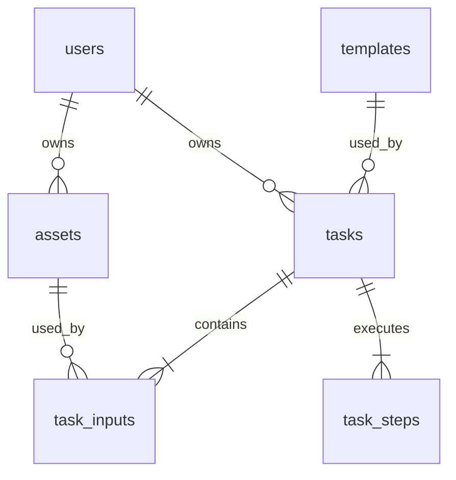

# 库表设计

状态：六表结构已在 MySQL 8.4.13 初始化，约束及业务读写已验证。

更新日期：2026-11-02。配套文档：[阶段二设计](phase-2-design.md)、[接口文档](api.md)。

阶段三沿用现有六表，没有新增字段、索引或迁移。页面联调使用独立的临时 MySQL 与文件目录，验证上传和任务写入；演示库保留原数据。参见[阶段三设计](phase-3-design.md)。

[阶段四](phase-4-design.md) 已接入任务、历史与结果读取，继续使用现有六表。没有新增表、字段、索引或迁移；浏览器联调使用隔离的临时数据库和文件目录。

## 1. 范围与维护

本文定义题目范围内的全部 6 张核心表。下方 DDL 与 `database/init/001-schema.sql` 一致，已在隔离测试库及演示库执行。本文是字段、约束和索引的维护入口。

数据库变化应同时更新本文、初始化 SQL、增量 SQL、Mapper 和受影响接口。接口字段变化还应更新接口文档。执行后的结构变化使用编号增量脚本；不只修改首次初始化脚本。

## 2. 数据库约定

| 项目 | 约定 |
| --- | --- |
| 数据库 | `xiaoying` |
| MySQL | 8.4.13，InnoDB |
| 默认字符集 | `utf8mb4`，排序规则 `utf8mb4_0900_ai_ci` |
| ID 和枚举 | ASCII，`ascii_bin`；精确区分大小写 |
| 业务 ID | `assets.id`、`tasks.id` 使用服务端生成的小写 UUID 字符串，36 字符 |
| 用户／模板 ID | 稳定字符串，最多 64 字符 |
| 时间 | `DATETIME(3)`；Java 写入 UTC，精确到毫秒；API 输出 ISO 8601 UTC |
| 字段命名 | 数据库 snake_case，Java 和 JSON camelCase |
| 外键 | 物理外键，删除和更新均 RESTRICT |
| 删除 | 无删除接口，无逻辑删除字段，无级联删除 |
| 初始时间 | 由应用显式写入；初始化用户使用 `UTC_TIMESTAMP(3)` |

`DATETIME` 本身不携带时区。Java、JDBC 会话和应用时间转换应统一为 UTC。cursor 应使用数据库已经保存的毫秒时间，避免纳秒精度造成边界不一致。

以下表中“无默认”表示 INSERT 应提供字段。`NULL` 表示字段允许为空且默认值为空。JSON 的内容约束由服务端验证，数据库只校验文中列出的结构约束。

## 3. 实体关系与取舍



- `assets` 与模板不绑定。上传时按目标模板校验，提交时按本次模板再次校验。
- `task_inputs` 保存有序输入。同一素材可用于不同任务，一个任务内不重复引用同一素材。
- `task_steps` 保存三个固定步骤，不建立通用工作流定义表。
- 分类使用模板上的代码和名称，不单独建立分类表。本题没有分类维护后台。
- `templates.category_name` 是分类名称的有限冗余。种子校验应保证同一分类代码仅对应一个名称。
- `tasks.template_title` 是任务创建时的标题快照。模板没有修改接口，初始化不覆盖已有模板；执行期间使用对应模板的要求和结果预置路径。
- 会话存于 Java 进程，不建立会话表。

物理外键只保证记录存在，不保证素材所有者等于任务所有者。创建任务的业务事务应显式校验归属。

## 4. 字段设计

### 4.1 `users`：演示用户

| 字段 | 类型 | 空值／默认 | 含义 |
| --- | --- | --- | --- |
| `id` | `VARCHAR(64)` ASCII | 非空，无默认 | 主键；`demo-alice` 或 `demo-bob` |
| `display_name` | `VARCHAR(64)` | 非空，无默认 | 显示名称 |
| `created_at` | `DATETIME(3)` | 非空，无默认 | 创建时间 |

不保存邮箱、密码、会员或积分。用户初始化内容为 `demo-alice / 小禾`、`demo-bob / 阿远`。

### 4.2 `templates`：制作模板

| 字段 | 类型 | 空值／默认 | 含义 |
| --- | --- | --- | --- |
| `id` | `VARCHAR(64)` ASCII | 非空，无默认 | 主键，对应种子 ID |
| `title` | `VARCHAR(120)` | 非空，无默认 | 模板标题 |
| `description` | `VARCHAR(1000)` | 非空，无默认 | 模板说明 |
| `category` | `VARCHAR(64)` ASCII | 非空，无默认 | 分类代码 |
| `category_name` | `VARCHAR(64)` | 非空，无默认 | 分类名称 |
| `cover_path` | `VARCHAR(512)` | 非空，无默认 | 相对于内置素材根目录的封面路径 |
| `required_image_count` | `SMALLINT UNSIGNED` | 非空，无默认 | 所需图片数量，正数 |
| `accepted_mime_types` | `JSON` | 非空，无默认 | 非空 MIME 字符串数组 |
| `max_file_size_bytes` | `BIGINT UNSIGNED` | 非空，无默认 | 单张文件最大字节数，正数 |
| `result_preset_path` | `VARCHAR(512)` | 非空，无默认 | 内置预置结果路径，不允许客户端提交 |
| `sort_order` | `INT UNSIGNED` | 非空，0 | 列表顺序，按 ID 打破同序值 |

索引 `idx_templates_category_sort(category, sort_order, id)` 支持按分类排序查询。种子导入前校验路径存在、分类名称一致、MIME 值在 JPEG／PNG 范围内。

### 4.3 `assets`：已上传素材

| 字段 | 类型 | 空值／默认 | 含义 |
| --- | --- | --- | --- |
| `id` | `CHAR(36)` ASCII | 非空，无默认 | 主键，素材 UUID |
| `user_id` | `VARCHAR(64)` ASCII | 非空，无默认 | 所有者，外键指向 `users.id` |
| `original_name` | `VARCHAR(255)` | 非空，无默认 | 文件显示名，不参与存储路径拼接 |
| `storage_path` | `VARCHAR(255)` ASCII | 非空，无默认 | 相对于 `STORAGE_ROOT` 的路径，唯一 |
| `mime_type` | `VARCHAR(32)` ASCII | 非空，无默认 | 服务端识别的 `image/jpeg` 或 `image/png` |
| `size_bytes` | `BIGINT UNSIGNED` | 非空，无默认 | 实际字节数，正数 |
| `created_at` | `DATETIME(3)` | 非空，无默认 | 上传完成并登记时间 |

存储路径形如 `uploads/{assetId}.png`。索引 `idx_assets_user(user_id)` 支持归属关联及外键；单素材读取先按主键定位，再检查用户。

只有文件保存成功的素材才入表，没有“上传中”行。文件写入与数据库事务无法原子提交，失败清理由应用执行，详见阶段二设计。

### 4.4 `tasks`：制作任务

| 字段 | 类型 | 空值／默认 | 含义 |
| --- | --- | --- | --- |
| `id` | `CHAR(36)` ASCII | 非空，无默认 | 主键，任务 UUID |
| `user_id` | `VARCHAR(64)` ASCII | 非空，无默认 | 所有者，外键指向用户 |
| `template_id` | `VARCHAR(64)` ASCII | 非空，无默认 | 外键指向模板 |
| `template_title` | `VARCHAR(120)` | 非空，无默认 | 创建时的标题快照 |
| `status` | `VARCHAR(16)` ASCII | 非空，`QUEUED` | 整体状态 |
| `stage` | `VARCHAR(32)` ASCII | `NULL` | 当前或最后执行阶段；排队／调度失败为空 |
| `version` | `BIGINT UNSIGNED` | 非空，0 | 每次可见状态事务递增的版本 |
| `failure_code` | `VARCHAR(64)` ASCII | `NULL` | 任务失败代码 |
| `failure_reason` | `VARCHAR(500)` | `NULL` | 可供用户理解的原因，不保存异常堆栈 |
| `result_path` | `VARCHAR(255)` ASCII | `NULL` | 成功结果在数据卷中的相对路径，唯一 |
| `created_at` | `DATETIME(3)` | 非空，无默认 | 受理时间 |
| `started_at` | `DATETIME(3)` | `NULL` | 首次开始执行时间 |
| `finished_at` | `DATETIME(3)` | `NULL` | 成功或失败时间 |
| `simulation_config` | `JSON` | 非空，无默认 | 解析默认值后的任务级模拟配置快照 |

`simulation_config` 固定保存两个字段：

```json
{
  "stepDelayMs": 3000,
  "failAtStage": null
}
```

配置的范围与枚举以接口文档为准。配置只在创建时写入，不随环境变量变化修改。

索引与查询：

| 索引 | 对应查询 |
| --- | --- |
| `idx_tasks_user_created(user_id, created_at DESC, id DESC)` | 个人历史与 cursor 翻页 |
| `idx_tasks_user_template_created(user_id, template_id, created_at DESC, id DESC)` | 制作页按模板查看历史 |
| `idx_tasks_user_status(user_id, status)` | 刷新后读取全部未完成任务 |
| `idx_tasks_template(template_id)` | 模板外键 |
| `uq_tasks_result(result_path)` | 防止多个任务登记同一路径；未成功时允许多个 NULL |

按任务 ID 批量查询使用主键并加用户条件。无需对失败原因或 JSON 字段建立索引。

### 4.5 `task_inputs`：有序输入

| 字段 | 类型 | 空值／默认 | 含义 |
| --- | --- | --- | --- |
| `task_id` | `CHAR(36)` ASCII | 非空，无默认 | 外键指向任务 |
| `position` | `SMALLINT UNSIGNED` | 非空，无默认 | 从 1 开始的上传位顺序 |
| `asset_id` | `CHAR(36)` ASCII | 非空，无默认 | 外键指向素材 |

主键为 `(task_id, position)`，唯一约束为 `(task_id, asset_id)`，索引 `idx_task_inputs_asset(asset_id)` 支持外键与引用查询。创建事务保证 position 连续、输入数量与模板一致，并校验素材归属。

### 4.6 `task_steps`：执行步骤

| 字段 | 类型 | 空值／默认 | 含义 |
| --- | --- | --- | --- |
| `task_id` | `CHAR(36)` ASCII | 非空，无默认 | 外键指向任务 |
| `stage` | `VARCHAR(32)` ASCII | 非空，无默认 | 阶段枚举 |
| `position` | `TINYINT UNSIGNED` | 非空，无默认 | 固定 1、2、3 |
| `status` | `VARCHAR(16)` ASCII | 非空，`PENDING` | 步骤状态 |
| `started_at` | `DATETIME(3)` | `NULL` | 实际开始时间 |
| `finished_at` | `DATETIME(3)` | `NULL` | 完成、失败或标记跳过的时间 |
| `failure_reason` | `VARCHAR(500)` | `NULL` | 本步骤失败原因，其他状态为空 |

主键为 `(task_id, stage)`，唯一约束为 `(task_id, position)`。固定映射为 1＝`MATERIAL_CHECK`、2＝`MOCK_GENERATION`、3＝`RESULT_FINALIZATION`。

`SKIPPED` 的 `started_at` 为空，`finished_at` 为任务失败时间。跳过步骤不复制失败原因，失败原因保存在任务和实际失败步骤。

## 5. 状态、约束与事务

状态枚举的权威定义见 [接口文档](api.md)。表约束使用同一组字符串，不用数据库 ENUM 类型。

| 任务状态 | stage | started_at | finished_at | 结果／失败 |
| --- | --- | --- | --- | --- |
| `QUEUED` | 空 | 空 | 空 | 均为空 |
| `RUNNING` | 非空 | 非空 | 空 | 均为空 |
| `SUCCEEDED` | `RESULT_FINALIZATION` | 非空 | 非空 | result_path 非空，失败字段为空 |
| `FAILED`，执行中失败 | 失败阶段 | 非空 | 非空 | result_path 为空，失败字段非空 |
| `FAILED`，调度失败 | 空 | 空 | 非空 | result_path 为空，失败字段非空 |

数据库检查枚举、位置和上述行内组合。任务和步骤的跨表一致性由事务保证。数据库不独立检查“恰好三个步骤”或“输入数量等于模板要求”，创建事务和测试负责这些规则。

步骤行内约束：PENDING 没有时间；RUNNING 只有开始时间；SUCCEEDED 有开始和完成时间；FAILED 还有原因；SKIPPED 只有完成时间。非失败步骤不保存原因。

状态更新使用任务主键、预期状态和 `version` 作条件。更新行数为 0 时不继续执行对应业务。步骤更新和任务 `version + 1` 在同一事务内完成。MyBatis-Plus 的通用更新不得绕过这些条件。

任务输入与模拟配置创建后不可变。查询不写入业务表。任务详情使用同一 REPEATABLE READ 只读事务读取任务和步骤；不把长时间文件操作放进事务。

## 6. 参考 DDL

以下建表 SQL 已写入初始化脚本，并在 MySQL 8.4.13 执行。本文与脚本的内容一致。

```sql
CREATE DATABASE IF NOT EXISTS xiaoying
    CHARACTER SET utf8mb4 COLLATE utf8mb4_0900_ai_ci;
USE xiaoying;

CREATE TABLE users (
    id VARCHAR(64) CHARACTER SET ascii COLLATE ascii_bin NOT NULL,
    display_name VARCHAR(64) NOT NULL,
    created_at DATETIME(3) NOT NULL,
    PRIMARY KEY (id)
) ENGINE=InnoDB;

CREATE TABLE templates (
    id VARCHAR(64) CHARACTER SET ascii COLLATE ascii_bin NOT NULL,
    title VARCHAR(120) NOT NULL,
    description VARCHAR(1000) NOT NULL,
    category VARCHAR(64) CHARACTER SET ascii COLLATE ascii_bin NOT NULL,
    category_name VARCHAR(64) NOT NULL,
    cover_path VARCHAR(512) NOT NULL,
    required_image_count SMALLINT UNSIGNED NOT NULL,
    accepted_mime_types JSON NOT NULL,
    max_file_size_bytes BIGINT UNSIGNED NOT NULL,
    result_preset_path VARCHAR(512) NOT NULL,
    sort_order INT UNSIGNED NOT NULL DEFAULT 0,
    PRIMARY KEY (id),
    KEY idx_templates_category_sort (category, sort_order, id),
    CONSTRAINT chk_templates_count CHECK (required_image_count > 0),
    CONSTRAINT chk_templates_size CHECK (max_file_size_bytes > 0),
    CONSTRAINT chk_templates_mime_array CHECK (
        JSON_TYPE(accepted_mime_types) = 'ARRAY'
        AND JSON_LENGTH(accepted_mime_types) > 0
    )
) ENGINE=InnoDB;

CREATE TABLE assets (
    id CHAR(36) CHARACTER SET ascii COLLATE ascii_bin NOT NULL,
    user_id VARCHAR(64) CHARACTER SET ascii COLLATE ascii_bin NOT NULL,
    original_name VARCHAR(255) NOT NULL,
    storage_path VARCHAR(255) CHARACTER SET ascii COLLATE ascii_bin NOT NULL,
    mime_type VARCHAR(32) CHARACTER SET ascii COLLATE ascii_bin NOT NULL,
    size_bytes BIGINT UNSIGNED NOT NULL,
    created_at DATETIME(3) NOT NULL,
    PRIMARY KEY (id),
    UNIQUE KEY uq_assets_storage (storage_path),
    KEY idx_assets_user (user_id),
    CONSTRAINT fk_assets_user FOREIGN KEY (user_id)
        REFERENCES users (id) ON DELETE RESTRICT ON UPDATE RESTRICT,
    CONSTRAINT chk_assets_size CHECK (size_bytes > 0),
    CONSTRAINT chk_assets_mime CHECK (mime_type IN ('image/jpeg', 'image/png'))
) ENGINE=InnoDB;

CREATE TABLE tasks (
    id CHAR(36) CHARACTER SET ascii COLLATE ascii_bin NOT NULL,
    user_id VARCHAR(64) CHARACTER SET ascii COLLATE ascii_bin NOT NULL,
    template_id VARCHAR(64) CHARACTER SET ascii COLLATE ascii_bin NOT NULL,
    template_title VARCHAR(120) NOT NULL,
    status VARCHAR(16) CHARACTER SET ascii COLLATE ascii_bin NOT NULL DEFAULT 'QUEUED',
    stage VARCHAR(32) CHARACTER SET ascii COLLATE ascii_bin NULL DEFAULT NULL,
    version BIGINT UNSIGNED NOT NULL DEFAULT 0,
    failure_code VARCHAR(64) CHARACTER SET ascii COLLATE ascii_bin NULL DEFAULT NULL,
    failure_reason VARCHAR(500) NULL DEFAULT NULL,
    result_path VARCHAR(255) CHARACTER SET ascii COLLATE ascii_bin NULL DEFAULT NULL,
    created_at DATETIME(3) NOT NULL,
    started_at DATETIME(3) NULL DEFAULT NULL,
    finished_at DATETIME(3) NULL DEFAULT NULL,
    simulation_config JSON NOT NULL,
    PRIMARY KEY (id),
    UNIQUE KEY uq_tasks_result (result_path),
    KEY idx_tasks_user_created (user_id, created_at DESC, id DESC),
    KEY idx_tasks_user_template_created (user_id, template_id, created_at DESC, id DESC),
    KEY idx_tasks_user_status (user_id, status),
    KEY idx_tasks_template (template_id),
    CONSTRAINT fk_tasks_user FOREIGN KEY (user_id)
        REFERENCES users (id) ON DELETE RESTRICT ON UPDATE RESTRICT,
    CONSTRAINT fk_tasks_template FOREIGN KEY (template_id)
        REFERENCES templates (id) ON DELETE RESTRICT ON UPDATE RESTRICT,
    CONSTRAINT chk_tasks_status CHECK (
        status IN ('QUEUED', 'RUNNING', 'SUCCEEDED', 'FAILED')
    ),
    CONSTRAINT chk_tasks_stage CHECK (
        stage IS NULL OR stage IN ('MATERIAL_CHECK', 'MOCK_GENERATION', 'RESULT_FINALIZATION')
    ),
    CONSTRAINT chk_tasks_simulation CHECK (JSON_TYPE(simulation_config) = 'OBJECT'),
    CONSTRAINT chk_tasks_state_fields CHECK (
        (status = 'QUEUED' AND stage IS NULL AND started_at IS NULL
            AND finished_at IS NULL AND result_path IS NULL
            AND failure_code IS NULL AND failure_reason IS NULL)
        OR
        (status = 'RUNNING' AND stage IS NOT NULL AND started_at IS NOT NULL
            AND finished_at IS NULL AND result_path IS NULL
            AND failure_code IS NULL AND failure_reason IS NULL)
        OR
        (status = 'SUCCEEDED' AND stage IS NOT NULL AND stage = 'RESULT_FINALIZATION'
            AND started_at IS NOT NULL AND finished_at IS NOT NULL
            AND result_path IS NOT NULL AND failure_code IS NULL AND failure_reason IS NULL)
        OR
        (status = 'FAILED' AND finished_at IS NOT NULL AND result_path IS NULL
            AND failure_code IS NOT NULL AND failure_reason IS NOT NULL
            AND ((stage IS NULL AND started_at IS NULL)
                OR (stage IS NOT NULL AND started_at IS NOT NULL)))
    )
) ENGINE=InnoDB;

CREATE TABLE task_inputs (
    task_id CHAR(36) CHARACTER SET ascii COLLATE ascii_bin NOT NULL,
    position SMALLINT UNSIGNED NOT NULL,
    asset_id CHAR(36) CHARACTER SET ascii COLLATE ascii_bin NOT NULL,
    PRIMARY KEY (task_id, position),
    UNIQUE KEY uq_task_inputs_asset (task_id, asset_id),
    KEY idx_task_inputs_asset (asset_id),
    CONSTRAINT fk_task_inputs_task FOREIGN KEY (task_id)
        REFERENCES tasks (id) ON DELETE RESTRICT ON UPDATE RESTRICT,
    CONSTRAINT fk_task_inputs_asset FOREIGN KEY (asset_id)
        REFERENCES assets (id) ON DELETE RESTRICT ON UPDATE RESTRICT,
    CONSTRAINT chk_task_inputs_position CHECK (position > 0)
) ENGINE=InnoDB;

CREATE TABLE task_steps (
    task_id CHAR(36) CHARACTER SET ascii COLLATE ascii_bin NOT NULL,
    stage VARCHAR(32) CHARACTER SET ascii COLLATE ascii_bin NOT NULL,
    position TINYINT UNSIGNED NOT NULL,
    status VARCHAR(16) CHARACTER SET ascii COLLATE ascii_bin NOT NULL DEFAULT 'PENDING',
    started_at DATETIME(3) NULL DEFAULT NULL,
    finished_at DATETIME(3) NULL DEFAULT NULL,
    failure_reason VARCHAR(500) NULL DEFAULT NULL,
    PRIMARY KEY (task_id, stage),
    UNIQUE KEY uq_task_steps_position (task_id, position),
    CONSTRAINT fk_task_steps_task FOREIGN KEY (task_id)
        REFERENCES tasks (id) ON DELETE RESTRICT ON UPDATE RESTRICT,
    CONSTRAINT chk_task_steps_order CHECK (
        (position = 1 AND stage = 'MATERIAL_CHECK')
        OR (position = 2 AND stage = 'MOCK_GENERATION')
        OR (position = 3 AND stage = 'RESULT_FINALIZATION')
    ),
    CONSTRAINT chk_task_steps_status CHECK (
        status IN ('PENDING', 'RUNNING', 'SUCCEEDED', 'FAILED', 'SKIPPED')
    ),
    CONSTRAINT chk_task_steps_state_fields CHECK (
        (status = 'PENDING' AND started_at IS NULL AND finished_at IS NULL AND failure_reason IS NULL)
        OR (status = 'RUNNING' AND started_at IS NOT NULL AND finished_at IS NULL AND failure_reason IS NULL)
        OR (status = 'SUCCEEDED' AND started_at IS NOT NULL AND finished_at IS NOT NULL AND failure_reason IS NULL)
        OR (status = 'FAILED' AND started_at IS NOT NULL AND finished_at IS NOT NULL AND failure_reason IS NOT NULL)
        OR (status = 'SKIPPED' AND started_at IS NULL AND finished_at IS NOT NULL AND failure_reason IS NULL)
    )
) ENGINE=InnoDB;
```

DDL 中的 CHECK 只约束当前行。时间先后顺序和跨表事务由业务代码与测试验证。不通过数据库触发器驱动任务。

## 7. 初始化与后续结构变更

首次初始化顺序：

1. 执行 `001-schema.sql`，建立 6 张表。
2. 执行 `002-demo-users.sql`，先以 `SET NAMES utf8mb4` 确定连接字符集，再写入两个中文演示用户。
3. Java 启动时读取 [模板种子](../assets/demo/templates.json)。
4. 校验所有种子及本地文件后，在事务中插入缺少的模板。
5. Java 确认数据库与种子可用后，通过就绪检查。

用户初始化脚本只在新数据库执行，不覆盖已有用户。模板初始化遇到已有 ID 时不更新该记录；种子变化不会静默改写现有数据库。必要的数据修订使用独立迁移脚本。

种子 `coverPath` 映射到 `cover_path`，`resultPresetPath` 映射到 `result_preset_path`，`categoryName` 映射到 `category_name`。`acceptedMimeTypes` 写为 JSON 数组。种子不是运行时接口的第二套数据源，接口读取数据库。

已有数据库的升级脚本放在 `database/migrations/`。脚本应记录编号、前置版本、变更内容和验证 SQL。README 记录已应用编号；本题不新增自动迁移框架或业务迁移表。回滚应说明是否可逆；不默认删除业务数据或数据卷。

## 8. 数据与 API 映射

| 数据库 | API | 规则 |
| --- | --- | --- |
| `users.id/display_name` | `User.id/displayName` | 会话对象只包含用户公开字段 |
| `templates.cover_path` | `Template.coverUrl` | 加 `/demo/` 前缀 |
| `templates.category_name` | `Template.categoryName` | 分类列表同样读取模板记录 |
| `assets.storage_path` | `Asset.previewUrl` | 生成 `/api/assets/{id}/content`，不返回磁盘路径 |
| `tasks.result_path` | `Task.resultUrl` | 仅成功任务生成 `/api/tasks/{id}/result` |
| `tasks.failure_code/failure_reason/stage` | `Task.failure.code/message/stage` | 仅 FAILED 组装；其他状态为 null |
| `task_inputs.position` | 创建请求 `assetIds` 的数组位置 | 数组下标＋1，不向客户端开放修改接口 |
| `task_steps` | `TaskDetail.steps` | 按 position 排序；状态与时间逐项映射 |
| `simulation_config` | 创建请求 `simulation` | 保存补齐默认值后的配置；不在普通查询响应中返回 |

## 9. 验证要求和来源

执行阶段应验证：外键拒绝孤立引用；唯一约束拒绝同任务重复素材和步骤；CHECK 拒绝非法状态组合；JSON 正确往返；UTC 毫秒时间与 cursor 一致；状态事务失败时整体回滚；不同用户记录隔离；初始化重跑不覆盖已有模板。

阶段二已执行真实 MySQL 测试。外键拒绝孤立素材引用，唯一约束拒绝同任务重复素材。CHECK 拒绝非法任务状态与步骤位置，JSON 和毫秒时间正确往返。HTTP 集成测试验证了任务／步骤提交、失败中断和用户隔离。重建 MySQL 及应用容器后，历史与模板记录保留。

当前状态更新使用注解 Mapper SQL，单表读写使用 MyBatis-Plus BaseMapper。JSON 字段在实体中保存为字符串，由 ObjectMapper 转换为业务结构。数据库实际 DDL 未偏离本文，无需新增迁移脚本。

MySQL 语法参考：[CHECK 约束](https://dev.mysql.com/doc/refman/8.4/en/create-table-check-constraints.html)、[外键约束](https://dev.mysql.com/doc/refman/8.4/en/create-table-foreign-keys.html)、[时间精度](https://dev.mysql.com/doc/refman/8.4/en/fractional-seconds.html)。

## 10. 变更记录

| 日期 | 变化 | 影响 |
| --- | --- | --- |
| 2026-11-02 | 首版 6 表、字段、约束、索引和参考 DDL | 供执行前审阅，尚未建表 |
| 2026-11-02 | 补齐 `category_name` 和按模板的历史索引 | 对齐现有种子、分类展示及制作页历史查询 |
| 2026-11-02 | 首次初始化及真实 MySQL 验证完成；用户种子显式设置 utf8mb4 | 修复中文导入编码，未改变表结构 |
