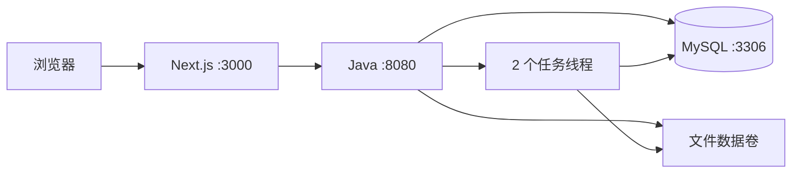

# 阶段二设计：工程初始化与后台制作流程

状态：用户已授权执行；阶段二实现、容器联调及持久化验证已完成。

更新日期：2026-11-02。范围依据：[需求与任务清单](requirements-and-task-list.md)、[原始题目](../timu.md)。

## 1. 文档职责与维护规则

阶段二持续维护以下三份文档，不为每次修改另建一套设计。用户另行要求建立的[阶段三设计](phase-3-design.md) 负责前端制作入口范围，并继续复用库表和接口文档：

| 文档 | 负责的内容 |
| --- | --- |
| 本文 | 执行范围、依赖、模块、运行方式、事务与执行流程、取舍和验收 |
| [库表设计](database-design.md) | 表、字段类型、默认值、约束、索引、初始化和结构变更 |
| [接口文档](api.md) | 路径、鉴权、请求响应、校验规则、错误码和调用示例 |

本文引用库表和接口约定，不重复列出完整字段。第一阶段文档保留为历史快照，当前实现以这三份文档为准。题目和用户新指令优先于设计稿。

后续修改遵循以下规则：

1. 修改字段或接口前，更新对应文档并记录影响。
2. 修改代码时，在同一工作批次同步 SQL、DTO、测试和调用方。
3. 提交前，检查跨文档引用、枚举、字段映射及示例。
4. 验证通过后，更新任务清单及文档末尾的变更记录。

文档中的“应”表示本设计的约束，“可”表示允许的选择。设计约束不自动成为题目硬性要求。

### 1.1 编码规范的采用方式

2026-11-02 用户确认以下规则：

- 前端按现有 [React＋TypeScript 规范](standards/ts-coding-rules.md) 执行，规范文件保持原样。
- 后端不照搬 [模块与目录规范](standards/backend-module-directory-standard.md) 的示例结构，采用本文第 5 节的项目目录。
- 业务 Service 采用接口与实现类分离，调用方依赖接口；辅助组件不强制增加接口。
- Java 注释按修订后的 [Java 开发规范](standards/java-development-standard.md) 执行，重点说明契约、边界和非直观规则。

上述决定已用于阶段二实现，未改变库表或 HTTP 协议。

## 2. 目标与范围

阶段二结束时，用户可以通过 HTTP 接口完成身份选择、模板查询、上传、提交、后台制作、历史查询和结果预览。任务关闭页面后仍执行，状态保存至 MySQL。

| 本次交付 | 完成范围 | 需求来源 |
| --- | --- | --- |
| 后端工程 | 复用用户模板，修正依赖，建立配置和启动入口 | R-01、R-13 |
| 前端工程 | Next.js 骨架、基础页、同源转发、lint／类型检查／构建命令 | R-01；完整页面留在阶段三、四 |
| 运行环境 | 三服务 Compose、Dockerfile、配置示例、数据卷 | 采用 R-14 的推荐方案 |
| 用户与模板 | 演示用户、会话、分类、模板、种子初始化 | R-02、R-10 |
| 素材 | 上传、服务端校验、保存和归属检查 | R-03 的后端部分 |
| 任务 | 快速受理、三个阶段、两线程执行、状态及结果持久化 | R-04 至 R-06 |
| 查询 | 个人历史、单个任务、批量状态、全部未完成任务 | 为 R-07 至 R-09 提供接口 |
| 质量与文档 | 后端核心测试、接口场景验证、启动说明、复用说明 | R-12、R-13 的本阶段部分 |

本次不完成完整业务页面、上传组件、多任务前端状态管理和视觉打磨。完整 CI 流水线留在阶段六。无需真实 AI、消息队列、Redis、对象存储或账号注册。

## 3. 已确认事项和本稿取舍

| 事项 | 方案 | 来源与理由 |
| --- | --- | --- |
| 身份 | 两个演示用户＋Java 会话 | 用户已确认 |
| 执行并发 | 2 个工作线程，其余排队 | 用户已确认 |
| 后端基础 | 复用用户模板，保留 MyBatis-Plus | 用户讨论后确定 |
| 后端目录 | 业务模块直接位于根包下，不增加 `modules` 层 | 用户确认不照搬目录规范示例 |
| 业务 Service | 接口与实现类分离 | 用户已确认；不为辅助组件机械增加接口 |
| 浏览器入口 | Next.js 同源转发 `/api/*` 和 `/demo/*` | 项目选型；题目也允许直接调用 Java |
| 响应结构 | 成功直接返回对象，错误返回结构化错误及 HTTP 状态 | 项目选型；与模板的统一包装不同 |
| 历史分页 | 创建时间与 ID 组成 cursor | 新任务插入时不依赖页码偏移 |
| 步骤记录 | 独立 `task_steps` 表 | 为执行顺序和失败中断提供持久化证据 |
| 排队容量 | 32，可配置 | 控制单进程待执行任务数量 |
| 模拟结果 | 复制本地预置 SVG | 题目允许预置结果；不声称合成上传图片 |
| 文件存储 | 本地目录和容器数据卷 | 独立运行，无外部存储服务 |
| 前端后续方案 | 每 2 秒轮询未完成任务 | 属于阶段四；本次提供所需接口 |

会话重启失效、任务重启不恢复、未引用素材不自动清理均属于已接受的简化边界。最终 README 应保留这些限制。

## 4. 版本与依赖

### 4.1 直接版本基线

| 组件 | 版本 | 决策 |
| --- | --- | --- |
| Java | 21 | 保留模板编译目标；当前本机为 21.0.10 |
| Maven Wrapper | 3.9.14 | 保留模板 Wrapper，替代第一阶段的本机 Maven 3.9.9 基线 |
| Spring Boot | 3.5.16 | 模板 3.5.3 升级到已选同系列补丁版本 |
| MyBatis-Plus | 3.5.9 | 保留模板版本，使用 Boot 3 Starter |
| MySQL | 8.4.13 | 8.4 系列 |
| Node.js | 24.14.0 | 前端开发与构建版本 |
| npm | 11.9.0 | 生成并保留 `package-lock.json` |
| Next.js | 16.4.3 | App Router |
| React／React DOM | 19.3.1 | 两者使用相同版本 |
| TypeScript | 5.9.3 | TypeScript 基线 |
| ESLint | 9.39.5 | 独立执行 lint |
| eslint-config-next | 16.4.3 | 与 Next.js 同版本 |

完整组合已在容器中编译、测试并启动。Java 容器实际为 21.0.13，Node.js 为 24.14.0，npm 为 11.9.0。基础镜像的 digest 记录在第 11 节。

### 4.2 后端依赖清单

| 依赖 | 来源／版本策略 | 用途 |
| --- | --- | --- |
| `spring-boot-starter-web` | Boot 3.5.16 | HTTP、JSON、会话和文件请求 |
| `spring-boot-starter-validation` | Boot 3.5.16 | 请求参数校验 |
| `mybatis-plus-spring-boot3-starter` | 3.5.9 | Mapper、基础数据操作及 JDBC 集成 |
| `mysql-connector-j` | Boot 依赖管理 | MySQL 驱动 |
| `lombok` | Boot 依赖管理 | 复用模板需要的注解 |
| `spring-boot-starter-test` | Boot 3.5.16，test scope | JUnit、Mockito、Spring 测试支持 |

不同时加入普通 MyBatis Starter。不引入 Hutool、Knife4j、Spring Security、Redis、MQ 或 Flyway；当前范围不需要这些依赖。数据库结构使用有编号的 SQL 文件维护，身份使用明确的会话校验。

不引入 MyBatis-Plus 分页插件或全局逻辑删除配置。历史使用 cursor SQL；本题没有删除功能。两张关联表使用复合主键和显式 Mapper SQL，不为适配通用 CRUD 添加无用途 ID。

常规单表操作使用 `BaseMapper`。任务状态更新使用带预期状态和版本的 SQL，避免通用更新覆盖终态。JSON 字段以字符串在 Mapper 边界读写，再由 ObjectMapper 解析为列表或模拟配置，无需自定义 TypeHandler。JSON、驼峰映射、UTC 毫秒时间及状态事务已通过真实 MySQL 验证。

### 4.3 前端依赖范围

本次引入表中前端依赖及 `@types/node`、`@types/react`、`@types/react-dom`。类型包分别限定在 24、19、19 主版本，并在首次安装后把解析结果写入锁文件。

本次不引入 TanStack Query、Vitest、React Testing Library 或 UI 组件库。后续实现对应功能时再确定精确版本。基础样式使用 CSS，不建立空的状态管理封装。

### 4.4 来源

- [Next.js 安装要求](https://nextjs.org/docs/app/getting-started/installation)。
- [Spring Boot 3.5 系统要求](https://docs.spring.io/spring-boot/3.5/system-requirements.html)。
- [MyBatis-Plus 安装说明](https://baomidou.com/getting-started/install/)：Boot 3 Starter 与依赖组合要求。
- [MyBatis-Plus 3.5.9 Boot 3 Starter POM](https://repo.maven.apache.org/maven2/com/baomidou/mybatis-plus-spring-boot3-starter/3.5.9/mybatis-plus-spring-boot3-starter-3.5.9.pom)。
- [Maven 3.9.14 POM](https://repo.maven.apache.org/maven2/org/apache/maven/apache-maven/3.9.14/apache-maven-3.9.14.pom)。
- [MySQL 版本说明](https://dev.mysql.com/doc/refman/8.4/en/which-version.html)。
- npm 元数据：[Next.js](https://registry.npmjs.org/next/16.4.3)、[React DOM](https://registry.npmjs.org/react-dom/19.3.1)、[TypeScript](https://registry.npmjs.org/typescript/5.9.3)、[ESLint](https://registry.npmjs.org/eslint/9.39.5)。

## 5. 模板复用与目标目录

来源：`C:\all\work\study\initialized-backend`。目标：本项目 `backend/`。原模板保持原样。

复用 POM 和 Maven Wrapper，参考模板的异常处理与健康检查组织方式，业务代码按本项目契约实现。排除 `.git`、`.idea`、`target` 和 `.env`。数据库连接读取环境变量。README 已记录复用来源与范围；来源没有 commit，不填写虚构版本。

应用名为 `xiaoying-backend`，Java 根包为 `com.anwen.xiaoying`。服务端口为 8080。Servlet context path 为根路径；Controller 自行映射 `/api`，静态资源映射 `/demo`。

目标结构如下，路径相对于 `C:\all\work\xiaoying`：

```text
frontend/
  src/app/{layout.tsx,page.tsx,globals.css}
  package.json
  package-lock.json
  next.config.ts
  tsconfig.json
  eslint.config.mjs
  Dockerfile
backend/
  .mvn/wrapper/
  mvnw
  mvnw.cmd
  pom.xml
  Dockerfile
  src/main/java/com/anwen/xiaoying/
    XiaoyingApplication.java
    config/
    common/
    identity/
    template/
    asset/
    task/
  src/main/resources/
    application.yml
  src/test/java/com/anwen/xiaoying/
database/
  init/001-schema.sql
  init/002-demo-users.sql
  migrations/                 后续实际发生结构变更时创建
assets/demo/                  已有模板种子、封面、结果及上传示例
scripts/                      已有素材脚本；按需增加验证脚本
docs/
  requirements-and-task-list.md
  phase-1-design.md            历史快照
  phase-2-design.md            本文
  database-design.md
  api.md
compose.yaml
.env.example
.gitignore
.dockerignore
README.md
AGENTS.md
timu.md
```

`{...}` 表示并列文件。业务模块内部按需要放 Controller、Service、Mapper、DTO 和实体，不预先创建空层。当前 SQL 使用 Mapper 注解，未建立空 XML 目录。两张复合主键表的 Mapper 使用显式方法。Mapper 只扫描标记 `@Mapper` 的接口，覆盖各业务模块。

业务 Service 的接口与实现分别放在模块内的 `service` 和 `service/impl`。例如，任务模块使用 `task/service/TaskService.java` 和 `task/service/impl/TaskServiceImpl.java`。接口说明业务能力，实现类组织规则、流程和事务；不因三个处理阶段而机械增加三套 Service。

## 6. 模块职责与运行入口



| 模块 | 负责 | 不负责 |
| --- | --- | --- |
| `identity` | 演示用户、会话建立／失效、当前用户读取 | 注册、密码、外部身份服务 |
| `template` | 查询、分类、种子导入及模板要求 | 模板管理后台 |
| `asset` | 图片校验、文件保存、素材归属和内容读取 | 制作任务调度 |
| `task` | 受理、状态转换、步骤执行、历史与结果 | 通用工作流平台 |
| `config` | 数据源、线程池、资源路径和配置绑定 | 业务校验 |
| `common` | 共享错误结构、异常映射 | 各模块业务规则 |

Next.js 只转发业务请求，不写数据库或执行制作。转发应保留 Cookie、Set-Cookie、multipart 请求和二进制响应。同源方案不启用模板的任意来源 CORS 配置。

## 7. 容器、配置和初始化

启动命令为 `docker compose up -d --build --wait`。Compose、前后端 Dockerfile 和 `.env.example` 已提供并验证。

Compose 包含 `frontend`、`backend`、`mysql`。数据库和上传／结果分别使用数据卷。前端向宿主机发布 3000；后端和 MySQL 默认仅供容器网络访问，调试可通过显式端口配置开放。

MySQL 就绪后启动 Java。Java 完成数据库连接与种子检查后再通过就绪检查。前端构建不依赖数据库在线，前端运行时再访问后端。

| 配置 | 默认／约束 | 用途 |
| --- | --- | --- |
| `JAVA_API_ORIGIN` | 构建时默认 `http://backend:8080` | Next.js rewrites 在构建时确定；修改目标需重新构建，现有 Compose 使用默认服务名 |
| `DB_URL` | 指向 MySQL 的 `xiaoying` 库，UTC | JDBC 连接 |
| `DB_USERNAME`、`DB_PASSWORD` | 通过环境变量设置 | 应用数据库账号 |
| `MYSQL_ROOT_PASSWORD` | Compose 初始化时设置 | MySQL 初始化，不传给应用 |
| `STORAGE_ROOT` | `/app/data` | 用户素材和任务结果目录 |
| `DEMO_MODE` | 演示环境 `true` | 演示用户入口和模拟参数覆盖 |
| `TASK_WORKERS` | 2，正整数 | 工作线程数 |
| `TASK_QUEUE_CAPACITY` | 32，正整数 | 排队容量 |
| `SIMULATION_STEP_DELAY_MS` | 3000，范围 0–30000 | 每个步骤的默认模拟耗时 |

本题启动配置使用 `DEMO_MODE=true`。关闭时，演示用户列表和身份选择接口返回 404，模拟参数覆盖返回 400；不因此提供另一套登录机制。

SQL 初始化和种子规则以库表文档为准。已有数据卷不重复执行首次建库脚本，升级使用显式增量脚本；不通过清空数据卷完成默认升级。

`assets/demo` 随后端打包。Docker 构建上下文设为仓库根目录。用户输入文件和生成结果保存在数据卷中，路径不依赖宿主机目录。

## 8. 任务受理、执行和事务

### 8.1 受理

1. 从会话取得用户 ID。
2. 检查模板、素材归属、数量、顺序、文件可读性及模拟参数。
3. 在事务中插入任务、任务输入和三个待执行步骤。
4. 提交事务后，将任务 ID 提交给线程池。
5. 返回 202、任务快照及 Location，不等待制作结束。

任务初始版本为 0。线程池不使用 CallerRunsPolicy，避免 HTTP 请求线程执行完整制作。执行器拒绝任务时，在新事务中将任务标记为调度失败，三个步骤标记为跳过，返回任务 ID。

若数据库故障使失败标记无法保存，服务端返回请求异常并记录任务 ID；不承诺可靠投递或自动恢复。普通请求参数错误发生在建任务前，不留下失败任务。

### 8.2 顺序执行

状态与枚举以接口文档为准。执行器只领取 `QUEUED` 任务；重复领取更新 0 行时退出，不再执行步骤。

1. 用短事务将任务和第一个步骤改为执行中。
2. 等待配置的耗时；若命中指定失败阶段，则抛出模拟失败。
3. 执行该阶段操作。
4. 用短事务完成该步骤并启动下一步骤，或写入任务终态。

三个步骤依次为素材检查、模拟生成、结果整理。素材检查重新确认文件可读及输入符合要求；模拟生成选择预置结果；结果整理复制结果文件并检查可读性。

步骤完成和下一步骤开始在同一事务中写入。每个可见状态事务递增任务 `version`。事务中同时更新任务与步骤记录，避免查询看到已成功任务和未完成步骤的组合。

延迟、文件读取和复制不占用数据库长事务。阶段失败时，在同一事务中写入任务失败、当前步骤失败和后续步骤跳过。先前成功步骤保留成功状态。

任务详情应在同一个 REPEATABLE READ 只读事务中读取任务和步骤。查询接口不改变任何执行状态。

### 8.3 文件与数据库的边界

上传时先验证并写入临时文件，再移入服务端生成的素材路径，最后插入素材记录。插入失败时尝试删除本次文件并记录清理失败；失败上传不返回可用素材 ID。

结果先写入任务临时路径，再移入最终路径，确认可读后写成功事务。失败时不提供 `resultUrl`。文件系统和 MySQL 没有分布式事务；进程崩溃可能遗留未引用文件，本题不自动清理。

用户文件名只用于显示，不参与目录拼接。API 不返回磁盘路径。公开 SVG 是预置资源，上传接口仍只接受 JPEG／PNG。

### 8.4 身份和刷新

Java 会话保存用户 ID。创建任务时固定所有者，切换用户不改变已受理任务。接口始终检查会话与记录归属。

刷新后，前端后续阶段应读取当前身份、历史首屏和全部未完成任务。批量状态接口应返回已进入终态的任务，便于前端停止轮询。请求异常不写入任务失败字段。

会话失效和后台任务生命周期独立。重新选择原演示用户可读取历史。服务重启后不恢复执行原队列，遗留非终态记录保持原样，README 应说明。

## 9. 执行顺序与阶段证据

用户已确认并授权执行以下工作。业务行为按项目 TDD 规则推进；静态配置采用构建和运行检查。具体完成证据见第 11 节。

| 顺序 | 工作 | 退出证据 |
| --- | --- | --- |
| 1 | 复用后端模板、建立前端骨架、锁定依赖 | Maven 编译和前端 lint／类型检查／构建通过 |
| 2 | 准备 Compose、配置、建库和种子 | 容器可启动；真实 MySQL 完成 Mapper 读写；重复启动不覆盖数据 |
| 3 | 实现会话、模板和上传 | 同源入口能够带会话上传；不同用户不能读取同一私有素材 |
| 4 | 实现任务状态和三个步骤 | 集成测试证明执行顺序与失败中断；任务／步骤持久化一致 |
| 5 | 实现查询、历史、批量状态和结果 | HTTP 场景验证分页、终态、所有者隔离及二进制结果 |
| 6 | 整理 README 与证据 | 需求、文档、SQL 和实现一致，记录未验证项 |

前端完整多任务状态隔离及旧响应丢弃属于阶段四，本次不宣称已经验证前端行为。

## 10. 验收矩阵

| 场景 | 验收结果 |
| --- | --- |
| 三个长耗时任务 | 前两个执行，第三个排队；每个任务只执行一次 |
| 停止查询／关闭页面 | 任务独立推进，重新查询可见结果 |
| 三个阶段分别失败 | 当前步骤失败，后续步骤跳过，失败阶段和原因可查 |
| 查询成功／失败任务 | 状态保持终态，不触发执行 |
| 查询请求异常 | HTTP 返回错误，不更改任务记录 |
| 切换演示用户 | 原用户任务继续执行，新用户无权读取原用户私有记录 |
| 历史翻页 | 相同创建时间的记录不因 cursor 边界而遗漏或重复 |
| 队列满 | 已创建任务记录调度失败；请求线程不执行制作 |
| 文件不可用 | 返回明确文件异常；任务结果查询不改写任务终态 |
| 容器和数据卷 | 应用重建后能读取持久化历史和文件，不宣称恢复未完成执行 |

核心流程使用 JUnit、Spring MockMvc 和隔离 MySQL 验证，未替换业务 Service 或 Mapper。并发测试只替换时间等待为事件闸门，分页测试使用固定时钟构造相同时间记录。测试断言 HTTP 行为与持久化结果，不以内部方法调用次数证明正确性。

## 11. 现状、执行条件和变更记录

2026-11-02 用户授权执行阶段二后，Docker 引擎已可用。工程、六表结构、17 个 HTTP 操作、两线程任务执行器和前端同源入口已落地。原后端模板未修改。阶段二结束时尚未创建提交；首次提交随后统一收录阶段二、三代码及阶段四设计，不补造历史阶段提交。最终验收 commit 留待完整交付确定。

### 11.1 已执行验证

| 检查 | 结果与证据 |
| --- | --- |
| 后端 `mvnw -B verify` | 16 项测试通过，打包成功；真实 MySQL 8.4.13 |
| 前端检查 | npm ci、ESLint、类型检查及 Next.js 生产构建通过 |
| 三服务首次启动 | `docker compose up -d --build --wait` 通过，入口 `http://localhost:3000` |
| 会话与上传 | 中文种子、Cookie 属性、multipart 转发、实际图片内容及所有者隔离通过 |
| 三阶段任务 | 成功及三个指定失败点通过；失败后后续步骤跳过；终态重复查询不变 |
| 并发及容量 | 事件闸门确认两任务执行、第三任务排队；测试队列容量设为 1，第四任务记录调度失败 |
| 查询 | 同一创建时间的 cursor 分页、用户／筛选不匹配拒绝、批量终态与输入顺序通过 |
| 文件异常 | 删除测试任务的结果文件后返回 FILE_UNAVAILABLE，成功状态保持不变；测试后恢复文件 |
| 数据库约束 | 外键、重复素材、步骤位置、状态 CHECK、JSON 与毫秒时间通过 |
| 完整 HTTP 链路 | `scripts/smoke.mjs` 通过；退出后 8 秒内不发送任务查询，再登录可见三个成功任务 |
| 数据卷 | 重建 MySQL、Java、Next.js 容器后，历史和上传／结果文件保留，文件 SHA-256 相同；模板仍为四条 |

复现命令见 [README](../README.md)。后端测试源码保留在 `backend/src/test/java/com/anwen/xiaoying/`。原始执行日志和运行生成的任务 ID 不加入 Git；smoke 脚本会重新生成本机证据。

已记录的工程创建、构建、测试、联调和文档整理跨度为 15:53–16:25（北京时间），约 32 分钟。人工投入未单独计时；此前设计讨论不计入该记录。

### 11.2 镜像与依赖记录

以下是 2026-11-02 实际构建使用的镜像标识。Dockerfile 和 Compose 仍使用标签；再次拉取标签可能得到更新后的镜像。

| 镜像标签 | 本次 digest |
| --- | --- |
| `mysql:8.4.13` | `sha256:a0225d1ea6631c8bc2385dc4c2faba17bbf1834ecf369e1659a9a382bd8d5dd7` |
| `eclipse-temurin:21-jdk-alpine` | `sha256:b78a1d385da875588e21207f07dddf9a1418849971ae857fb24c8f3a7d441a72` |
| `eclipse-temurin:21-jre-alpine` | `sha256:82cf3d9ccbe1ed46252008d51b2f2329e6b9e8a2f4394c4bebefc3ea7f4b1372` |
| `node:24.14.0-alpine` | `sha256:7fddd9ddeae8196abf4a3ef2de34e11f7b1a722119f91f28ddf1e99dcafdf114` |

生产依赖 audit 为 0 项。完整 npm audit 为 16 项中危项，来自开发工具链的 minimatch 依赖及其影响链；ESLint 9.39.5 提示已停止维护。当前保留已确认的直接版本，未通过跨大版本覆盖间接依赖消除报告。后续升级需要重新验证 lint 和插件兼容性。

### 11.3 后续边界

阶段三已接入分类、模板详情、上传位与提交回执，并验证当前表单的用户／模板／素材切换隔离，见[阶段三设计](phase-3-design.md)。页面关闭后的后端执行沿用阶段二验证结论；前端任务刷新恢复、轮询停止、历史与多任务展示属于阶段四。CI、完整页面验收和最终交付材料仍按后续任务推进。

| 日期 | 变化 | 原因 |
| --- | --- | --- |
| 2026-11-02 | 首版；拆出库表和接口文档 | 用户要求在执行前建立并持续维护三份文档 |
| 2026-11-02 | Maven 基线改为 Wrapper 3.9.14；不引入 Hutool／Knife4j | 保留模板 Wrapper，依赖限定到本阶段用途；待用户审阅 |
| 2026-11-02 | 前端规范原样采用；后端沿用本项目目录；业务 Service 接口与实现分离；精简 Java 注释要求 | 用户对规范评审的四项决定 |
| 2026-11-02 | 阶段二实现与容器验收完成；记录实际 JSON 映射、注解 SQL、依赖告警和验证证据 | 用户授权执行；三份文档与代码同步维护 |
